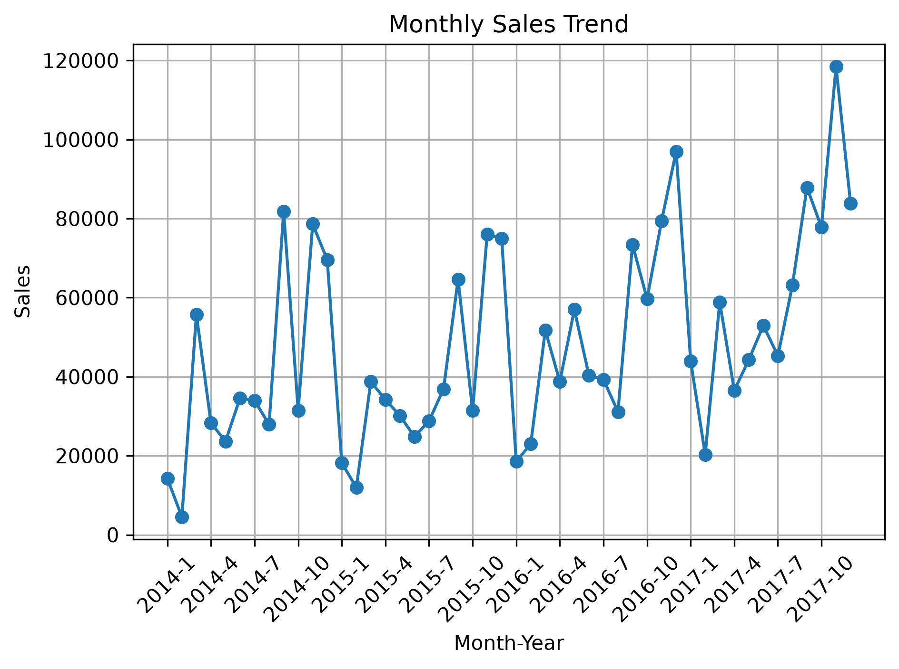
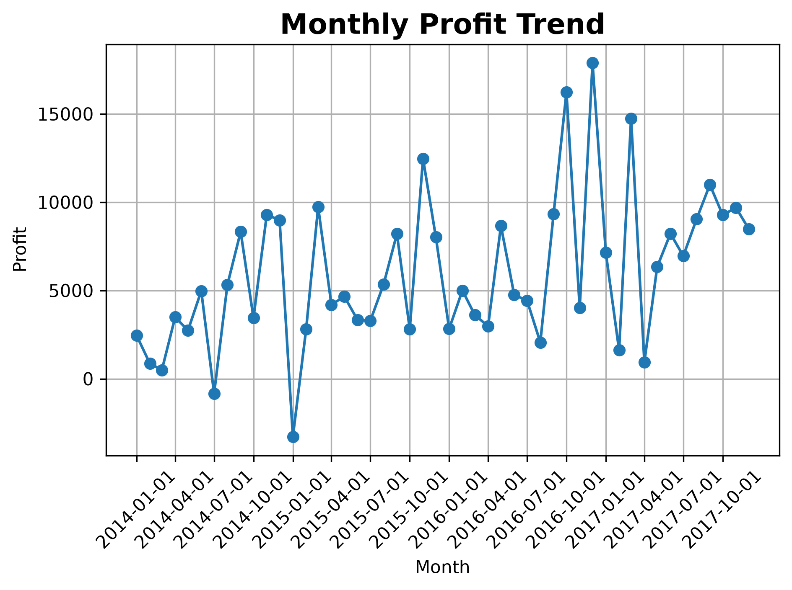
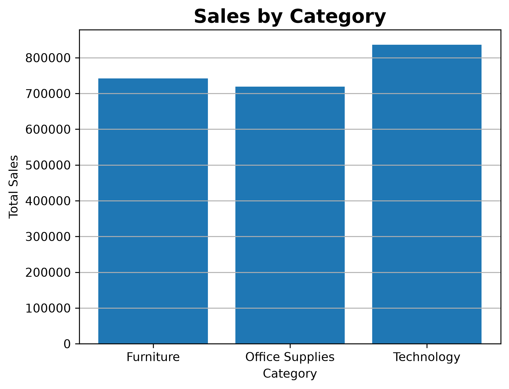
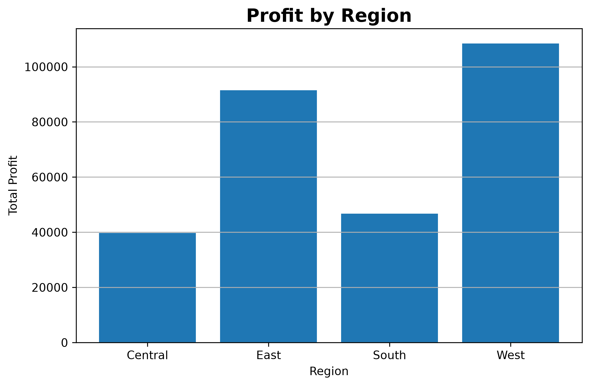
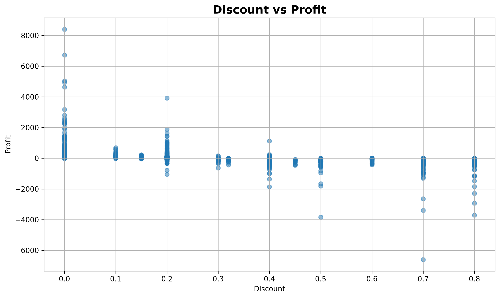

# Sales Performance Analysis & Business Insights 📊

## Project Overview

This project focuses on analyzing Superstore sales data to identify sales trends, profit performance, category insights, regional analysis, customer segment behavior, and the impact of discounts on profitability.

The objective is to transform raw sales data into meaningful business insights using Python data analysis techniques.

---

## Objectives

- Analyze sales and profit trends
- Identify top-performing categories and regions
- Understand customer segment performance
- Analyze the impact of discounts on profitability
- Generate actionable business recommendations

---

## Tools & Technologies

- Python
- Pandas
- NumPy
- Matplotlib
- Seaborn
- Jupyter Notebook

---

## Dataset

**Dataset:** Superstore Sales Dataset

The dataset contains information about:

- Orders
- Customers
- Products
- Sales
- Discounts
- Profit
- Regions

---

## Data Cleaning

Performed data preparation steps:

- Checked missing values
- Removed duplicate records
- Converted date columns
- Prepared dataset for analysis

---

## Exploratory Data Analysis (EDA)

Performed analysis on:

- Monthly Sales Trend
- Monthly Profit Trend
- Sales by Category
- Profit by Region
- Sales by Customer Segment
- Discount vs Profit Analysis
- Top 10 Products Analysis
- Top 10 Customers Analysis
- Correlation Analysis

---

# Data Visualizations 📈

## Monthly Sales Trend



## Monthly Profit Trend



## Sales by Category



## Profit by Region



## Discount vs Profit Analysis



---

# Key Business Insights 💡

- Total sales generated were approximately **2.29 million (dataset currency)**.
- Total profit generated was approximately **286K (dataset currency)**.
- Consumer segment contributed the highest revenue.
- Higher discounts can negatively impact profitability.
- Sales performance varies across different months and regions.

---

# Project Structure

```
Sales_Performance_Analysis/

├── Dataset/
│   ├── Sample - Superstore.csv
│   └── Superstore_Cleaned.csv
│
├── Notebook/
│   └── Sales_Performance_Analysis.ipynb
│
├── Image/
│   ├── Monthly_Sales_Trend.png
│   ├── Monthly_Profit_Trend.png
│   ├── Sales_by_Category.png
│   ├── Profit_by_Region.png
│   └── Discount_vs_Profit.png
│
├── Report/
│   └── Sales_Performance_Analysis_Report.pdf
│
└── README.md
```

---

# Conclusion

This project demonstrates how Python can be used for data cleaning, exploratory data analysis, visualization, and extracting actionable business insights from raw sales data.

The analysis helps understand business performance and supports data-driven decision-making.

---

# Author

**Vineet Shukla**

Data Analytics Enthusiast

**Skills:**  
Python | SQL | Power BI | Excel | Data Analysis
